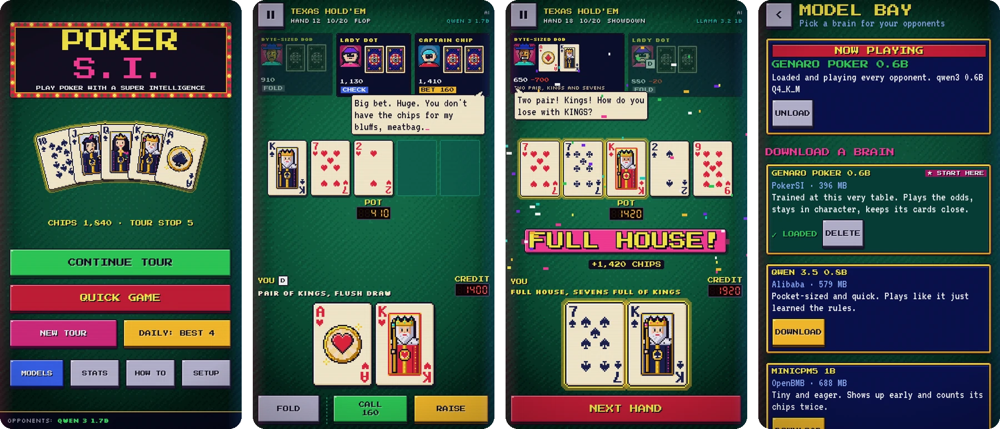
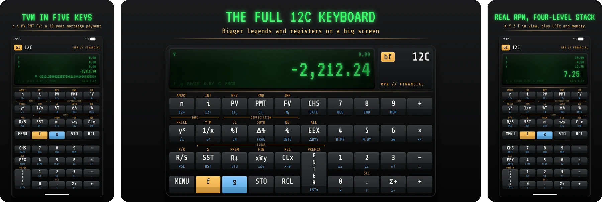
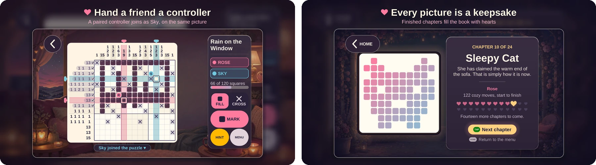
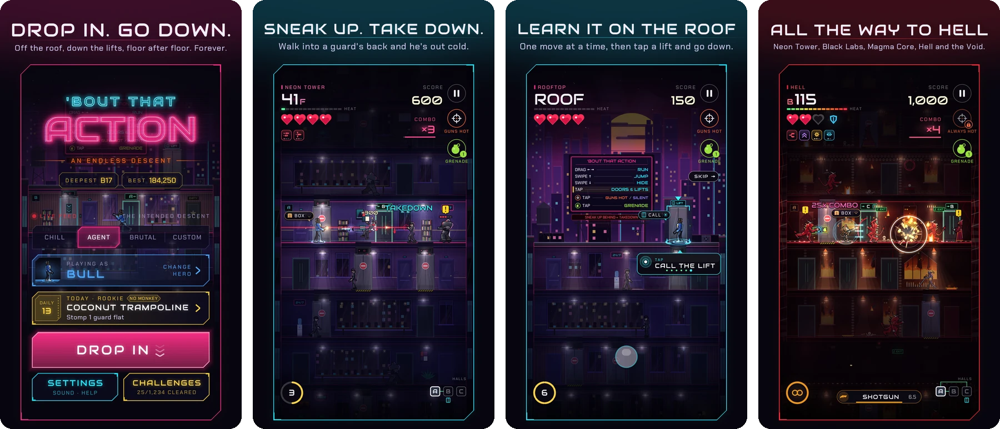
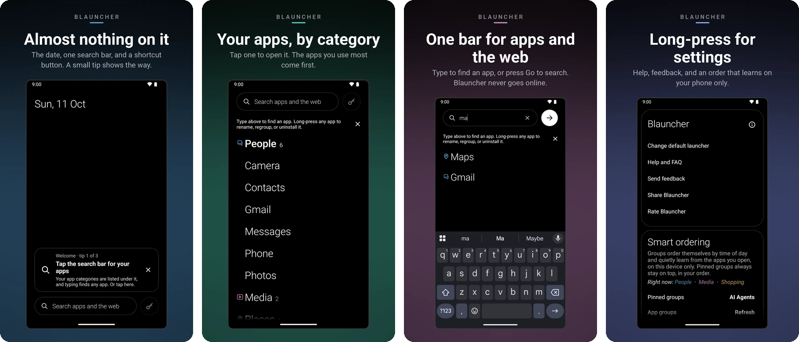

  I build small models that run on your device, games with endless procedurally generated levels, and software that collects zero data.

## On device

  <a href="https://divid3.com">
    <picture>
      <source media="(prefers-color-scheme: light)" srcset="https://raw.githubusercontent.com/bradflaugher/divid3/main/docs/routing-light.gif">
      
    </picture>
  </a>
   
  <a href="https://github.com/bradflaugher/divid3"><b>divid3</b></a>
  embeds the query in the browser and picks the search engine.
  <a href="https://divid3.com">divid3.com</a>

  
   
  <a href="https://github.com/bradflaugher/post-training"><b>post-training</b></a>
  is a word game run by an 11.8M model in the browser.
  <a href="https://post-training.win">post-training.win</a>

  
   
  <a href="https://github.com/bradflaugher/PokerSI"><b>PokerSI</b></a>
  plays the hand on the phone.
  <a href="https://github.com/bradflaugher/genaro-poker"><b>genaro</b></a>,
  my fine-tune, is the model in the other seats:
  <a href="https://huggingface.co/predbrad/Genaro-poker">0.6B</a>
  and
  <a href="https://huggingface.co/predbrad/Genaro-poker-1.7B">1.7B</a>,
  llama.cpp, on the device.

## Game Boy

<table>
  <tr>
    <td align="center" width="50%">
      
       
      <a href="https://github.com/bradflaugher/open-world"><b>open-world</b></a>
    </td>
    <td align="center" width="50%">
      
       
      <a href="https://github.com/bradflaugher/infinite-best"><b>infinite-best</b></a>
    </td>
  </tr>
  <tr>
    <td align="center" width="50%">
      
       
      <a href="https://github.com/bradflaugher/alignment"><b>alignment</b></a>
    </td>
    <td align="center" width="50%">
      
       
      <a href="https://github.com/bradflaugher/speedy-purple-peter"><b>speedy-purple-peter</b></a>
    </td>
  </tr>
</table>

## Android

  
   
  <a href="https://github.com/bradflaugher/bf-12c"><b>bf-12c</b></a>
  ·
  <a href="https://play.google.com/store/apps/details?id=com.bradflaugher.bf12c">Google Play</a>

  
   
  <a href="https://github.com/bradflaugher/CozyGrams"><b>CozyGrams</b></a>
  ·
  <a href="https://play.google.com/store/apps/details?id=com.cozygrams.tv">Google Play</a>

  
   
  <a href="https://github.com/bradflaugher/bout-that-action"><b>'Bout That Action</b></a>
  ·
  <a href="https://play.google.com/store/apps/details?id=com.bradflaugher.aboutthataction">Google Play</a>

  
   
  <a href="https://github.com/bradflaugher/blauncher"><b>blauncher</b></a>
  ·
  <a href="https://play.google.com/store/apps/details?id=com.bradflaugher.blauncher">Google Play</a>

## Book

  
   
  <a href="https://github.com/bradflaugher/AI-Harmony-Book"><b>AI Harmony</b></a>

